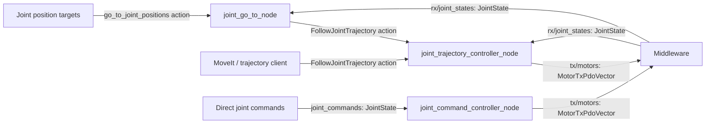
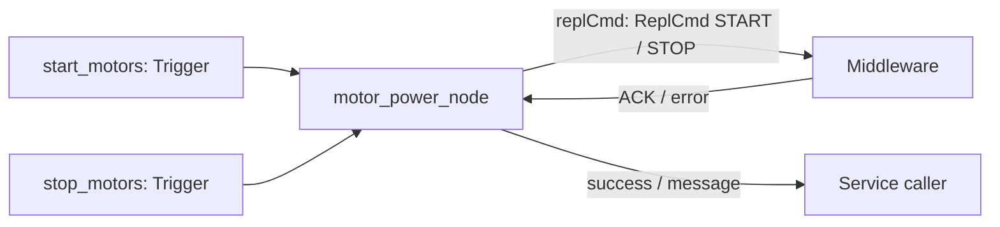

# advrf_ros2_motors_controller

Three ways to command the robot:

| Mode | Input | Launch | What it does |
| --- | --- | --- | --- |
| **GoTo** | `go_to_joint_positions` action | `go_to.launch.py` | Generates a trajectory to target joint positions, then executes it. |
| **Trajectory** | `FollowJointTrajectory` action | `trajectory.launch.py` | Executes a trajectory supplied by your client or MoveIt. |
| **Direct** | `joint_commands` topic (`JointState`) | `joint.launch.py` | Sends joint position/velocity references directly to the motors. |

**Motor startup/shutdown is separate:** `motors.launch.py` exposes
`start_motors` and `stop_motors` services through the middleware.

Choose one command mode for standalone launches. The rqt panel can switch between
GoTo and direct mode using the enable services described below. GoTo already includes
the trajectory controller.
The motor power node can run alongside any mode.

## Quick start

From the workspace root:

```bash
source /opt/ros/jazzy/setup.bash
colcon build --packages-up-to advrf_ros2_motors_controller
source install/setup.bash
```

### With EC_CFG

```bash
export EC_CFG=/path/to/robot/ec_cfg.yaml

ros2 launch advrf_ros2_motors_controller go_to.launch.py \
  namespace:=/advrf/miranda
```

Loads the robot mapping and `ros2/config/joint_config.yaml` from the paths in
`ec_cfg.yaml`. Optional `trajectory_config.yaml` overrides the shared parameters.

### Without EC_CFG

```bash
ros2 launch advrf_ros2_motors_controller go_to.launch.py \
  namespace:=/advrf/miranda \
  joint_config:=/path/to/joint_config.yaml \
  trajectory_config:=/path/to/trajectory_config.yaml \
  robot_id_map:=/path/to/robot_id_map.yaml
```

`trajectory_config` is optional. Adjust joint names, limits and gains for your robot.

### Start / stop motors

In another terminal with the same environment:

```bash
ros2 launch advrf_ros2_motors_controller motors.launch.py \
  namespace:=/advrf/miranda control_mode:=position
```

Without `EC_CFG`, also pass `joint_config` and `robot_id_map` as above.
Modes: `position`, `impedance`, `velocity`, `torque`, `current`.

```bash
ros2 service call /advrf/miranda/start_motors std_srvs/srv/Trigger '{}'
# Cancel any motion before stopping motors.
ros2 service call /advrf/miranda/stop_motors std_srvs/srv/Trigger '{}'
```

By default START requests existing drive gains (`gains.type=0`); this requires
middleware support for omitting unspecified protobuf gains. To send explicit START
gains, add a power-node block to your `joint_config.yaml`:

```yaml
/**/motor_power_node:
  ros__parameters:
    # Example matching the manually validated position START payload.
    # Applies to EVERY motor managed by this node; validate for that motor set.
    start_gains: [0.1, 0.0, 0.0005, 0.0, 0.0]
```

You can also override START gains explicitly at launch (takes precedence over YAML):

```bash
ros2 launch advrf_ros2_motors_controller motors.launch.py \
  namespace:=/advrf/miranda control_mode:=position \
  start_gains:='[0.1, 0.0, 0.0005, 0.0, 0.0]'
```

The power node logs its configured START mode and gains at startup. This override
applies to the motor-power launch, not the panel.

The order is `[pos_kp, pos_kd, tor_kp, tor_ki, tor_kd]`. With
`control_mode:=position`, START sends both `value=59` and `gains.type=59` with
these values. Empty/absent `start_gains` preserves the existing behavior. The
parameter is read-only after startup; restart the power node after editing it.
These are START gains, separate from cyclic PDO `gains` in joint configuration;
the middleware/drive determines how cyclic gains affect the active controller.

### Send a GoTo

```bash
ros2 action send_goal /advrf/miranda/go_to_joint_positions \
  advrf_interfaces/action/GoToJointPositions \
  "{joint_names: [shoulder_pan_joint, elbow_joint], positions: [0.2, -0.1], velocity_scaling: 0.2, acceleration_scaling: 0.2}" \
  --feedback
```

Positions are in radians. Other joints hold their measured positions.

### Trajectory or direct mode

Instead of the GoTo launch, choose one of these:

```bash
# Execute trajectories supplied by your client or MoveIt.
ros2 launch advrf_ros2_motors_controller trajectory.launch.py \
  namespace:=/advrf/miranda

# Or send JointState references directly on joint_commands.
ros2 launch advrf_ros2_motors_controller joint.launch.py \
  namespace:=/advrf/miranda
```

Without `EC_CFG`, pass `joint_config` and `robot_id_map` as above.
For trajectory mode, `trajectory_config` is also available.
If the trajectory controller is already running, start GoTo with
`start_trajectory_controller:=false`.

## Inputs / outputs

Names below are relative to the launch namespace.



The default trajectory action is `advrf_motors_controller/follow_joint_trajectory`.



## Local rqt motor panel

The English-language panel uses this package's GoTo action, direct
`joint_commands` input and motor power services. No MoveIt, URDF or ros2_control is required. Joint names and
slider limits are read from `joint_config.yaml` (`joints`, `position_lower`,
`position_upper`), and continuous velocity bounds use `max_velocity`. Supported ROS parameter selectors are `/**`,
`/**/joint_go_to_node`, `joint_go_to_node`, and the fully qualified GoTo node name.
Keep these shared joint definitions in `joint_config`, rather than overriding
them in `trajectory_config`.

The panel is a client only. `panel.launch.py` opens rqt; it never starts motor
controllers, GoTo/action servers, power nodes, the middleware, or visualization.
The robot bringup owns these processes. For Miranda, use the configuration's
`ros2/launcher/start.sh` to start the complete stack, or start that launcher with
`panel:=false` before opening the client separately:

```bash
source /opt/ros/jazzy/setup.bash
source install/setup.bash
ros2 launch advrf_ros2_motors_controller panel.launch.py \
  namespace:=/advrf/miranda joint_config:=/path/to/joint_config.yaml
```

The only panel launch arguments are `namespace` and `joint_config`; the latter
can be resolved from `EC_CFG` / `ROS2_CFG`. Controller modes, motor IDs, gains and
profile selection belong to the robot bringup/controller launches. The old
`start_controllers` option has been removed. Backend availability is shown in
the panel, and commands are disabled when their required endpoints are missing.
START/STOP buttons remain explicit operator requests to existing motor services.
The native middleware must already be running. No motors start automatically.

Or open only the plugin, also available under **Plugins → Robot Tools → ADVRF Motors**:

```bash
ros2 run rqt_gui rqt_gui --force-discover \
  --standalone advrf_ros2_motors_controller.motor_panel.MotorPanel \
  --args --joint-config /path/to/joint_config.yaml --namespace /advrf/miranda
```

The panel waits for a complete finite feedback snapshot on `rx/joint_states`
and initializes targets from measured positions within the configured limits.
Feedback and targets are displayed separately. Check **Command** beside each
joint to include it in motion requests. At least one joint must be selected.
Motor START/STOP services still apply to all joints in the power-node configuration.

- **GoTo:** editing sliders only prepares targets. **Go to targets** sends the
  selected joints using the velocity and acceleration scaling (both default to
  10%); the GoTo controller holds unselected joints at their measured positions.
- **Continuous joint commands:** click **Start continuous commands**, then adjust
  the selected sliders. The panel publishes position-only `JointState` messages
  on `joint_commands` at 20 Hz. References start at measured positions and move
  towards each slider target, bounded by that joint's configured `max_velocity`
  times **Velocity scaling**. This is a velocity-limited position ramp, not a
  trajectory planner; acceleration scaling applies only to GoTo. Unselected joints
  are omitted from direct messages. Select the joints before starting the stream.
- **Stop continuous commands:** stops publishing without sending motor STOP.
  Missing/out-of-limits feedback, a UI timer delay over 0.25 s, or loss of the
  `joint_commands` subscriber also stops the stream. Restart is always explicit.
  Driver/middleware command-loss behavior determines the physical response.

Changing mode disables the other controller first and waits for its response,
then enables the selected controller. The trajectory controller rejects mode
changes while a trajectory is active or reserved. Disabling or enabling it
clears its previous hold, so returning from direct mode never restores an old
trajectory target. Mode/joint selection is locked during motion or streaming.
Targets resynchronize to measured positions after a successful mode change.
**Apply mode** retries a failed setup. Both mode services are required for switching between GoTo and continuous
commands. A GoTo-only setup can enable trajectory mode without the direct service
when no `joint_commands` subscriber is present. An existing direct subscriber
without its gate service keeps mode setup blocked. These services gate publication from these
nodes; they do not arbitrate other publishers or external mode-service clients.

**Sync targets to feedback** updates targets without moving the robot; it does
not calibrate encoders.

**START motors** and **STOP motors** call the existing Trigger services and show
their returned success/message. They do not infer physical drive state. STOP
stops continuous publication immediately. For an active panel-owned GoTo, it
requests cancellation and waits for the terminal result before requesting motor
STOP. Cancelling motion alone does not stop drives.
Missing/stale feedback (0.5 s) or positions outside limits disable START and new
GoTo requests; the controller applies its own feedback timeout independently.
STOP remains available without feedback. Only one panel should command the robot;
this UI does not arbitrate requests from other clients.

Closing the panel stops continuous publication and attempts to cancel an accepted
active goal but does not send motor STOP. A lost service/action response leaves the relevant operation pending;
check the middleware/supervisor rather than assuming it failed. The software STOP
button is not an emergency stop, and middleware command-loss protection remains
necessary.

Offscreen integration test with simulated feedback, GoTo and motor services:

```bash
ROS_DOMAIN_ID=218 ROS_LOCALHOST_ONLY=1 QT_QPA_PLATFORM=offscreen \
  ROS_LOG_DIR=/tmp/advrf_panel_test_logs \
  python3 src/advrf_ros2_motors_controller/test/test_motor_panel.py
```

### Controller publication gates

The direct and trajectory controllers each accept the initial ROS parameter
`command_enabled` (default `true` for backward compatibility) and expose:

| Service | Type | Behavior |
| --- | --- | --- |
| `set_direct_enabled` | `std_srvs/SetBool` | Accept/drop incoming `joint_commands`; does not store or cyclically replay old commands. |
| `set_trajectory_enabled` | `std_srvs/SetBool` | Enable trajectory goals and cyclic output, or disable both and clear hold. Rejects changes during an active/reserved goal. |

The Miranda robot bringup starts direct disabled and trajectory enabled. The panel disables
the other pipeline before enabling the requested one. Use only one panel/controller
client per robot. These gates neither START nor STOP physical drives and do not
clear middleware-retained commands.

### Middleware motor profiles

The launches can derive START and cyclic PDO gains from the existing middleware
motor profile YAML, using the selected `control_mode`. With `EC_CFG` set, the
profile directory is discovered as `motor/` beside `robot.robot_control_path`.
The matching file is selected by its entries' numeric `control_mode`, not its
filename. For Miranda, `position` selects `miranda_pos_3b.yaml` (0x3B) and
`impedance` selects `miranda_imp_d4.yaml` (0xD4). Only one matching file is allowed;
missing/ambiguous profiles cause a launch error.

```bash
# From the Miranda configuration ros2/launcher directory:
./start.sh control_mode:=position

# Or select a profile source explicitly while retaining the current joint config/IDs.
./start.sh control_mode:=position \
  motor_profiles_dir:=/path/to/robot_control/motor
# Alternatively: motor_profile:=/path/to/robot_control/motor/miranda_pos_3b.yaml
```

Profile loading creates per-joint runtime parameter overrides; it does not rewrite
middleware files or change EtherCAT IDs. Selected joints, limits and IDs still come
from `joint_config.yaml` and `robot_id_map`. Extra profile entries such as the gripper
are not automatically added to the controlled joints. The motor mode is fixed at
startup when profile gains are loaded; restart with the new mode/profile to change it.
This drive mode is independent of the panel's GoTo/continuous command mode.

Profile names are matched directly to ROS joints. If every profile entry has
identical gains, those uniform gains can also be applied to renamed ROS joints.
For different per-motor gains with renamed joints, explicitly add an aligned list
in the shared `joint_config.yaml` parameters:

```yaml
/**:
  ros__parameters:
    joints: [shoulder_pan_joint, shoulder_lift_joint]
    profile_joints: [yaw_1, pitch_1]
    # Keep the usual limits and other shared parameters here.
```

The generated `joint_gains` and `start_joint_gains` arrays contain five values per
configured joint in `joints` order. They feed both the direct/trajectory PDO
converters and the explicit START gain fields. An explicit nonempty `start_gains`
parameter/launch argument overrides START profile gains only; omit it to use the
profile consistently for both START and cyclic commands.

If neither EC_CFG nor an explicit profile source is provided, existing shared
`gains` / optional `start_gains` behavior is retained. A specified profile source
never silently falls back to zero gains. Loading profiles and opening the panel
do not activate motors or initiate movement.
