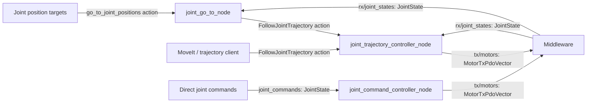
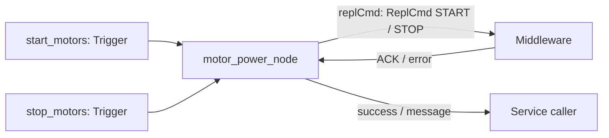

# advrf_ros2_motors_controller

Three ways to command the robot:

| Mode | Input | Launch | What it does |
| --- | --- | --- | --- |
| **GoTo** | `go_to_joint_positions` action | `go_to.launch.py` | Generates a trajectory to target joint positions, then executes it. |
| **Trajectory** | `FollowJointTrajectory` action | `trajectory.launch.py` | Executes a trajectory supplied by your client or MoveIt. |
| **Direct** | `joint_commands` topic (`JointState`) | `joint.launch.py` | Sends joint position/velocity references directly to the motors. |

**Motor startup/shutdown is separate:** `motors.launch.py` exposes
`start_motors` and `stop_motors` services through the middleware.

Choose one command mode. GoTo already includes the trajectory controller.
The motor power node can run alongside any mode.

## Quick start

From the workspace root:

```bash
source /opt/ros/jazzy/setup.bash
colcon build --packages-up-to advrf_ros2_motors_controller
source install/setup.bash
```

### With EC_CFG

```bash
export EC_CFG=/path/to/robot/ec_cfg.yaml
unset ROS2_CFG

ros2 launch advrf_ros2_motors_controller go_to.launch.py \
  namespace:=/advrf/miranda
```

Loads the robot mapping and `ros2/config/joint_config.yaml` from the paths in
`ec_cfg.yaml`. Optional `trajectory_config.yaml` overrides the shared parameters.

### Without EC_CFG

```bash
ros2 launch advrf_ros2_motors_controller go_to.launch.py \
  namespace:=/advrf/miranda \
  joint_config:=/path/to/joint_config.yaml \
  trajectory_config:=/path/to/trajectory_config.yaml \
  robot_id_map:=/path/to/robot_id_map.yaml
```

`trajectory_config` is optional. Adjust joint names, limits and gains for your robot.

### Start / stop motors

In another terminal with the same environment:

```bash
ros2 launch advrf_ros2_motors_controller motors.launch.py \
  namespace:=/advrf/miranda control_mode:=position
```

Without `EC_CFG`, also pass `joint_config` and `robot_id_map` as above.
Modes: `position`, `impedance`, `velocity`, `torque`, `current`.

```bash
ros2 service call /advrf/miranda/start_motors std_srvs/srv/Trigger '{}'
# Cancel any motion before stopping motors.
ros2 service call /advrf/miranda/stop_motors std_srvs/srv/Trigger '{}'
```

START preserves existing drive gains with the updated middleware converter.

### Send a GoTo

```bash
ros2 action send_goal /advrf/miranda/go_to_joint_positions \
  advrf_interfaces/action/GoToJointPositions \
  "{joint_names: [shoulder_pan_joint, elbow_joint], positions: [0.2, -0.1], velocity_scaling: 0.2, acceleration_scaling: 0.2}" \
  --feedback
```

Positions are in radians. Other joints hold their measured positions.

### Trajectory or direct mode

Instead of the GoTo launch, choose one of these:

```bash
# Execute trajectories supplied by your client or MoveIt.
ros2 launch advrf_ros2_motors_controller trajectory.launch.py \
  namespace:=/advrf/miranda

# Or send JointState references directly on joint_commands.
ros2 launch advrf_ros2_motors_controller joint.launch.py \
  namespace:=/advrf/miranda
```

Without `EC_CFG`, pass `joint_config` and `robot_id_map` as above.
For trajectory mode, `trajectory_config` is also available.
If the trajectory controller is already running, start GoTo with
`start_trajectory_controller:=false`.

## Inputs / outputs

Names below are relative to the launch namespace.



The default trajectory action is `advrf_motors_controller/follow_joint_trajectory`.


